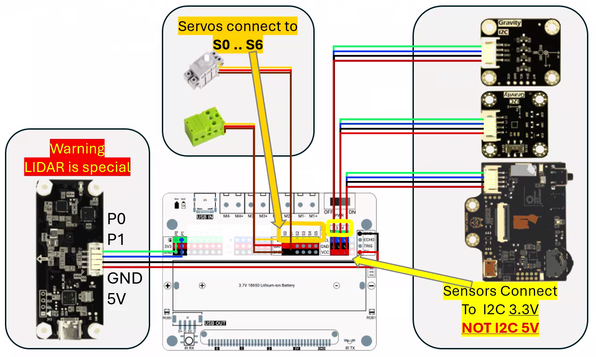

# Participant Guide: K10 Bot Contest

For sound conversion, storage, and playback instructions, see [Sound: Convert,
Store, and Play](ai-udp-client.md#sound-convert-store-and-play). Use audio you
have permission to use. Sound playback pauses shock detection and several
sensor/UI activities.
Read this guide before assembling or programming your bot. The rules below
describe the current contest format; ask the organizers to confirm event timing,
scoring, and safety procedures for your session.

## Introduction

This guide covers the supplied hardware, build constraints, and controller
setup for the aMaker contest.

## Contest Format
Build a remote-controlled bot that protects its balloon. There will be several
arena rounds against one or more other bots. The current format is:
1. Your opponent inflates and attaches your bot's balloon.
2. Each round starts with one minute in autonomous mode, followed by three
	minutes when remote control is allowed.

## Supplied Components

Check your kit against the items provided at the event:

- UniHiker K10 controller board with screen and camera
- LiDAR sensor (emits invisible laser light; follow the safety instructions below)
- Accelerometer and geomagnetic sensors
- Expansion board with battery holder, power switch, and charging connector
- One 18650 battery. **Check polarity before inserting it.**
- LEGO beams, plates, wheels, axles, tracks, and gears
- Two continuous-rotation servos (green) and two positional servos (grey)
- Toothpicks and balloons

## Build Rules and Wiring

Build the chassis with the provided parts. Use a transparent sheet only where
needed to protect electronics, as allowed by the event build rules.

With the board powered off:

- Seat the K10 board in the expansion board.
- Connect servos to the expansion-board ports S0-S5.
- Connect the I2C sensors and HuskyLens to the I2C 3.3 V header.
- Connect the LiDAR wires as shown in the wiring diagram: green to P0, blue to
	P1, red to 5 V, and black to GND.

**LiDAR safety:** the sensor emits invisible 905 nm laser light and is not
certified as Class 1. Never look into the sensor aperture while it is powered.
Mount and aim it as shown in the diagram, toward the floor and away from people.

You can control the bot from a computer using autonomous code, a keyboard,
mouse, or joystick. Check contest rules with the organizers before using
autonomous control during an event.

## Building your bot

### Constraints
1. Protect electronic components from toothpicks using the supplied building pieces or a transparent sheet.
2. Keep the camera's approximately 90-degree field of view clear.
3. Keep the LiDAR's approximately 120-degree horizontal field of view clear and aim it toward the floor for safety.
4. Your opponent will inflate and attach your balloon.

### Bot movement 

#### Tank mode
One motor on left track, one right track. 
Motors running in same direction => going forward / backward.
Motors running in opposite direction => turning on itself.

#### Car mode
One motor on the differential in and two wheels on the differential out, angular servo controls two direction wheels. Like a car. 

#### Design tips

* Tank and car layouts are starting points; other drive mechanisms are possible.
* The green continuous-rotation servos are relatively slow. Gearing can trade
	speed for torque, or vice versa.

### Continuous-rotation servos

Motor speed is controlled from -100 to +100. Gearing can increase wheel speed
or torque depending on the ratio.

Mounting motors can be tricky because the holes are not symmetrical; some are
only half-depth.

### Positional servos

* Positional servos can be commanded through a 0-270 degree range.
* They attempt to hold position and have no overload protection. Excessive
	force can damage or burn out a servo.
 

### Mounting the toothpick

Possible designs include a fixed toothpick at the end of a pole or one attached
to an articulated arm. Keep sharp points and moving linkages away from people.
- ...

### Mounting the balloons

You will inflate and attach a balloon to your opponent's bot, and your opponent
will do the same for yours. Follow the organizer's instructions for balloon
placement; do not alter or interfere with another participant's balloon.

### Build tips

* Double-check battery polarity before installing the battery.
* Confirm servo connector orientation before powering the board.
* Keep the charging connector and power switch accessible.
* Build and test incrementally; a small change is easier to debug than a pile
	of clever ideas at once.
* For mechanism inspiration, see [The LEGO Power Functions Idea Book by
	Yoshihito Isogawa](https://archive.org/details/legopowerfunctio0000isog_f2e0/page/4/mode/2up).
	The [idea gallery](contest-guide-ideas.png) shows a few examples.

## Coding part

### Contest firmware

The controller board is supplied with custom contest firmware.

#### Setup WiFi (optional)
If the board cannot connect to a previously configured Wi-Fi network, it starts
an access point named `amaker-XXXXX`; the exact name and IP address appear on
the screen. The access point password is `amaker-club`. Connect your computer
to that network, then read the bot IP address and five-character master token
from the screen. Your controller needs both to register over UDP.

#### UDP (port 24642)
The firmware exposes contest-control services over UDP port `24642`. Commands
use the [binary protocol](binary-protocol.html).

### Coding your controller

#### Code your own client
Write a controller that communicates with the firmware over UDP. Register with
the token shown on screen, keep the heartbeat active, then send supported
motor, servo, LED, or sensor commands.

Start from [quickstart](quickstart.html), then use [communication](communication.html) and [binary-protocol](binary-protocol.html) for the full protocol details.

#### Tips
An example client is available in the repository. Start with it, then tune the
controller to your bot instead of expecting one default setup to win the arena.

## Personalization

Use removable paper or transparent sheets to decorate the bot; avoid applying
stickers or ink directly to supplied parts. Keep status indicators and the
camera/LiDAR fields of view unobstructed. Short sound cues can add character,
but do not play sounds while relying on shock detection or sensor/UI updates.
Follow the [sound guide](ai-udp-client.md#sound-convert-store-and-play) and use
audio you have permission to use.